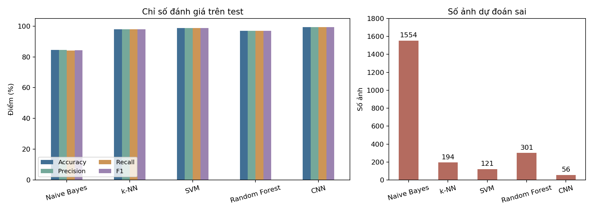
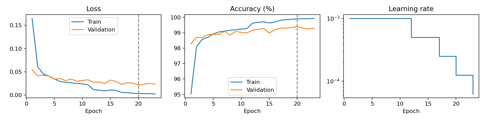
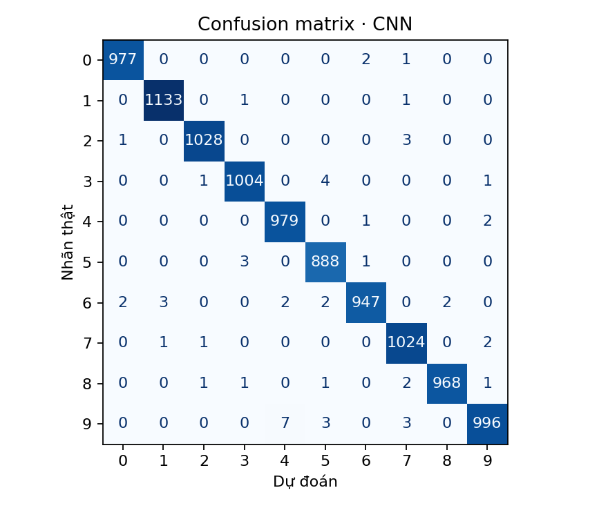
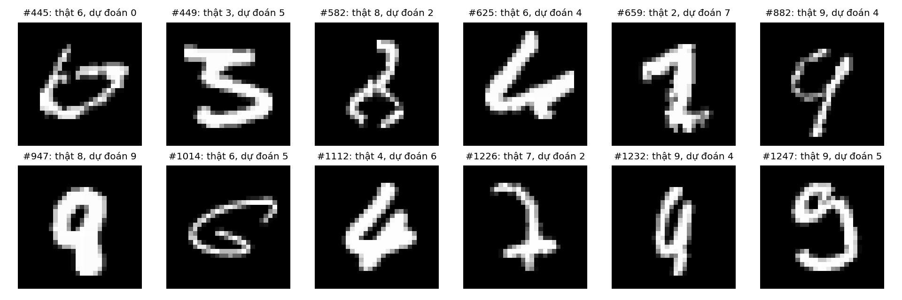

# Nhận Dạng Chữ Số Viết Tay Trên Bộ Dữ Liệu MNIST

Bài tập lớn học phần Nhận dạng mẫu — Học kỳ II, Năm học 2025–2026  
Trường Đại học Thủy Lợi  

Nhóm thực hiện: Nhóm 03 (Lớp S26-65TTNT)  
- Đoàn Anh Vũ — MSV: 2351267280  
- Nguyễn Hồng Nguyên — MSV: 2351267273  

---

## 1. Tổng quan đề tài

Dự án tập trung giải quyết bài toán phân lớp chữ số viết tay từ 0 đến 9 trên bộ dữ liệu chuẩn MNIST (Modified National Institute of Standards and Technology). Mục tiêu cốt lõi là so sánh đối chuẩn hiệu năng giữa các thuật toán học máy truyền thống (Naive Bayes, k-Nearest Neighbors, Support Vector Machine, Random Forest) kết hợp các kỹ thuật trích xuất đặc trưng (Deskewing, PCA) với mạng nơ-ron tích chập (Convolutional Neural Network - CNN).

Bên cạnh thực nghiệm mô hình, dự án phát triển hệ thống giao diện tương tác thời gian thực bằng FastAPI và bảng vẽ số hóa, hỗ trợ nhận dạng trực tiếp từ nét vẽ tay hoặc tệp ảnh chụp thực tế.

---

## 2. Kết quả đối chuẩn thực nghiệm

Mọi mô hình được đánh giá trên cùng tập kiểm thử chính thức gồm 10.000 mẫu độc lập. Các chỉ số Precision, Recall và F1-Score được tính theo phương pháp trung bình vĩ mô (Macro-average) trên 10 lớp.

| Mô hình | Đặc trưng đầu vào | Kích thước đặc trưng | Accuracy (%) | Macro Precision (%) | Macro Recall (%) | Macro F1 (%) | Số mẫu sai (trên 10.000) |
|---|---|:---:|:---:|:---:|:---:|:---:|:---:|
| Bernoulli Naive Bayes | Binarized Pixels (ngưỡng 0.2) | 784 | 84.46 | 84.58 | 84.20 | 84.27 | 1.554 |
| Random Forest (150 cây) | Cường độ pixel gốc [0, 1] | 784 | 96.99 | 96.98 | 96.97 | 96.97 | 301 |
| k-Nearest Neighbors (k=3) | Nắn nghiêng (Deskew) + PCA 95% | 113 | 98.06 | 98.06 | 98.04 | 98.05 | 194 |
| SVM (Kernel RBF, C=5.0) | Nắn nghiêng (Deskew) + PCA 95% | 113 | 98.79 | 98.78 | 98.79 | 98.78 | 121 |
| Modern CNN | Tensor ảnh 2D [0, 1] | 1 × 28 × 28 | **99.44** | **99.43** | **99.43** | **99.43** | **56** |



---

## 3. Giao thức dữ liệu và tiền xử lý

### 3.1. Phân chia tập dữ liệu
Bộ dữ liệu gồm 70.000 ảnh kích thước 28 × 28 pixel. Giao thức thực nghiệm phân chia nghiêm ngặt nhằm tránh hiện tượng rò rỉ dữ liệu (data leakage):
- Tập huấn luyện (Train Set): 50.000 mẫu, dùng để khớp trọng số mô hình và ước lượng không gian biến đổi đặc trưng (fit PCA).
- Tập kiểm định (Validation Set): 10.000 mẫu, dùng để tinh chỉnh siêu tham số và kích hoạt cơ chế Early Stopping trong huấn luyện mạng nơ-ron.
- Tập kiểm thử (Test Set): 10.000 mẫu chính thức từ MNIST, được cô lập hoàn toàn và chỉ sử dụng cho lượt đánh giá cuối cùng.

Phép phân chia sử dụng lấy mẫu phân tầng (Stratified Sampling, ngẫu nhiên với seed 42) để bảo toàn tỷ lệ nhãn đồng đều giữa các tập con.

### 3.2. Không gian đặc trưng và kỹ thuật tiền xử lý
- Nắn nghiêng theo mô-men ảnh (Deskewing): Khử độ nghiêng tự nhiên của nét chữ viết tay dựa trên tỷ số mô-men trung tâm bậc hai $\mu_{11} / \mu_{02}$. Phép biến đổi Affine được áp dụng để đưa trục chữ số về phương thẳng đứng.
- Phân tích thành phần chính (PCA): Ước lượng trên 50.000 ảnh tập huấn luyện đã qua nắn nghiêng. Ngưỡng giữ lại 95% phương sai tích lũy giúp nén không gian biểu diễn từ 784 chiều xuống còn 113 chiều, giảm tải đáng kể chi phí tính toán cho k-NN và SVM mà vẫn duy trì độ phân giải thông tin cao.
- Tách nét ảnh chụp thực tế: Đối với ảnh chụp từ camera hoặc giấy có kẻ ô ly, thuật toán sử dụng phép biến đổi hình thái học Blackhat để trích xuất tương phản cục bộ của nét mực, phân đoạn thành phần liên thông lớn nhất ở trung tâm và bù trừ độ dày nét trước khi co giãn về kích thước chuẩn 20 × 20 và đặt vào khung 28 × 28 theo tọa độ trọng tâm (Center of Mass).

---

## 4. Chi tiết kiến trúc mô hình tối ưu (Modern CNN)

Mô hình đạt độ chính xác cao nhất là mạng nơ-ron tích chập với cấu trúc phân tầng gồm 3 khối Convolution:
- Khối tích chập 1: Conv2D(1 -> 32, kernel 3×3, padding 1) -> BatchNorm2d -> ReLU -> MaxPool2d(2×2).
- Khối tích chập 2: Conv2D(32 -> 64, kernel 3×3, padding 1) -> BatchNorm2d -> ReLU -> MaxPool2d(2×2).
- Khối tích chập 3: Conv2D(64 -> 128, kernel 3×3) -> BatchNorm2d -> ReLU -> MaxPool2d(2×2).
- Khối phân loại: Flatten -> Dropout(0.4) -> Linear(512, 128) -> ReLU -> Dropout(0.2) -> Linear(128, 10).
- Tổng số lượng tham số có thể huấn luyện: 160.074 tham số.

Chiến lược huấn luyện:
- Thuật toán tối ưu: Adam (Learning Rate khởi tạo 0.001, Weight Decay 0.0001).
- Kích thước batch: 64 cho tập train, 256 cho tập validation.
- Bộ điều chỉnh tốc độ học: `ReduceLROnPlateau` giám sát validation loss với hệ số giảm 0.5, patience 1 epoch, mức tối thiểu 1e-5.
- Cơ chế dừng sớm (Early Stopping): Patience 3 epoch với ngưỡng biến thiên tối thiểu min_delta 0.0001.

Quá trình huấn luyện thực tế dừng ở epoch 23 và khôi phục checkpoint tốt nhất tại epoch 20 (Validation Loss đạt 0.0218, Validation Accuracy đạt 99.41%).



---

## 5. Phân tích kết quả và ma trận nhầm lẫn

### 5.1. Ma trận nhầm lẫn của CNN
Trên 10.000 ảnh kiểm thử, mô hình chỉ dự đoán sai 56 ảnh (độ chính xác 99.44%). Ma trận nhầm lẫn phản ánh tỷ lệ phân loại chính xác đồng đều trên tất cả các lớp chữ số, dao động từ 98.9% (lớp 9) đến 99.8% (lớp 1).



### 5.2. Phân tích các trường hợp nhận dạng sai
Phân tích các mẫu lỗi cho thấy phần lớn các ca dự đoán sai bắt nguồn từ nét viết bị biến dạng nghiêm trọng, đứt đoạn hoặc có đặc điểm hình học trùng lặp giữa hai ký số:
- Chữ số 4 viết hở nét trên đầu bị nhầm thành chữ số 9.
- Chữ số 7 có nét gạch ngang giữa thân hoặc cong móc phần đuôi bị nhầm thành chữ số 2.
- Chữ số 5 viết thiếu nét móc dưới hoặc nét ngang quá dài bị phân loại nhầm sang chữ số 3 hoặc chữ số 8.



---

## 6. Cấu trúc thư mục dự án

```
.
├── app/                        # Máy chủ backend FastAPI và giao diện web tương tác
│   ├── static/                 # Tài nguyên tĩnh giao diện (HTML, CSS, JS)
│   └── server.py               # REST API nạp mô hình và xử lý suy luận
├── data/                       # Dữ liệu nguồn MNIST (mnist.npz)
├── docs/                       # Tài liệu đề bài và hướng dẫn thực hiện
├── notebooks/                  # Jupyter Notebooks thực nghiệm
│   ├── 01_EDA_Truc_Quan_MNIST.ipynb      # Khám phá dữ liệu, PCA và t-SNE
│   └── 02_Tien_Xu_Ly_Train_MNIST.ipynb   # Tiền xử lý, huấn luyện và đánh giá 5 mô hình
├── reports/                    # Báo cáo chuyên đề và tài liệu thuyết minh
│   ├── figures/                # Biểu đồ đánh giá thực nghiệm
│   ├── Bang_Phan_Cong_Cong_Viec_Nhom_03.docx
│   ├── Nhom3_AnhVu_HongNguyen.pdf        # Báo cáo kỹ thuật chi tiết (28 trang)
│   └── Thuyet_Trinh_MNIST_Nhom_03_11_Slide.pptx
├── saved_models/               # Trọng số mô hình đã huấn luyện (.pt, .joblib, .json)
├── src/                        # Mã nguồn logic xử lý dùng chung
│   ├── config.py               # Đường dẫn và hằng số toàn cục
│   ├── data_loader.py          # Nạp dữ liệu và phân chia tập train/val/test
│   ├── features.py             # Nắn nghiêng (Deskew), PCA và trích xuất HOG
│   ├── image_preprocessing.py  # Thuật toán tách nét chữ số cho ảnh thực tế
│   └── models.py               # Định nghĩa kiến trúc PyTorch CNN và factory mô hình
├── tests/                      # Bộ kiểm thử tự động (Unit & Integration tests)
├── download_mnist.py           # Script tải lại bộ dữ liệu MNIST chính thức
├── requirements.txt            # Danh sách thư viện phụ thuộc
├── run_app.py                  # Script khởi chạy ứng dụng web demo
└── train_notebook_models.py    # Script tự động thực thi tuần tự quá trình huấn luyện
```

---

## 7. Hướng dẫn cài đặt và khởi chạy

### 7.1. Chuẩn bị môi trường
Yêu cầu hệ thống: Python phiên bản từ 3.10 trở lên. Khuyến nghị khởi tạo môi trường ảo độc lập:

```bash
# Khởi tạo môi trường ảo
python -m venv .venv

# Kích hoạt môi trường ảo
# Trên Windows:
.venv\Scripts\activate
# Trên Linux / macOS:
source .venv/bin/activate

# Cài đặt danh mục thư viện phụ thuộc
pip install -r requirements.txt
```

### 7.2. Khởi chạy ứng dụng Web tương tác
Khởi động máy chủ dịch vụ nội bộ:

```bash
python run_app.py
```

Sau khi khởi chạy thành công, truy cập giao diện trên trình duyệt tại địa chỉ: `http://127.0.0.1:8000`.  
Hệ thống cung cấp bảng vẽ kỹ thuật số 280 × 280 pixel, hỗ trợ lựa chọn linh hoạt giữa 5 mô hình học máy, hiển thị phân phối xác suất dự đoán và độ trễ xử lý (latency) theo thời gian thực.

### 7.3. Huấn luyện lại mô hình
Để tái lập toàn bộ quy trình huấn luyện từ đầu và xuất các checkpoint mô hình:
- Mở và chạy tuần tự các cell trong notebook `notebooks/02_Tien_Xu_Ly_Train_MNIST.ipynb`, hoặc:
- Thực thi trực tiếp qua dòng lệnh:
  ```bash
  python train_notebook_models.py
  ```

### 7.4. Chạy kiểm thử tự động
Bộ kiểm thử bao gồm 31 bài kiểm tra tính toàn vẹn dữ liệu, các phép biến đổi đặc trưng, kiến trúc mạng và API:

```bash
# Kiểm thử toàn diện pipeline và backend API
python -m unittest tests.test_pipeline -v

# Kiểm thử thuật toán chuẩn hóa pixel đầu vào ở giao diện frontend (yêu cầu Node.js)
node tests/test_upload_pixels.js
```
