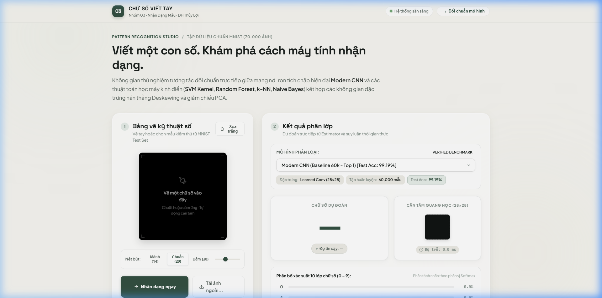
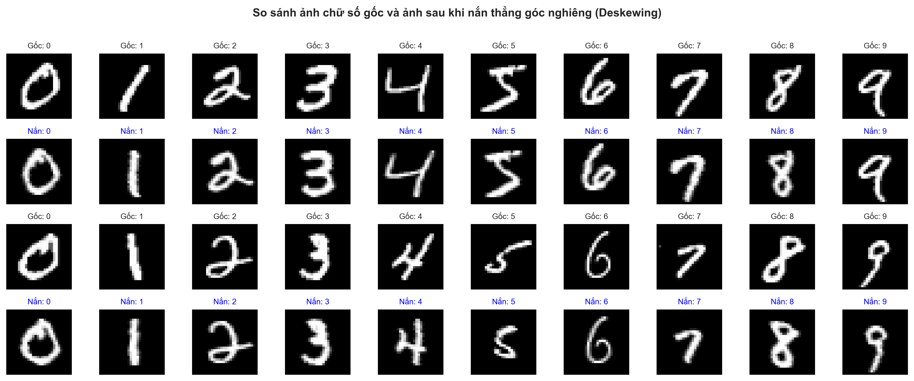
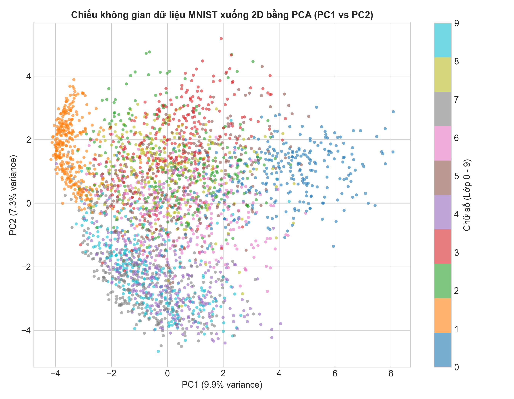
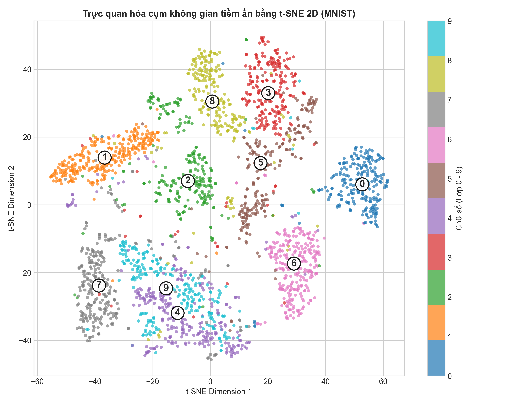
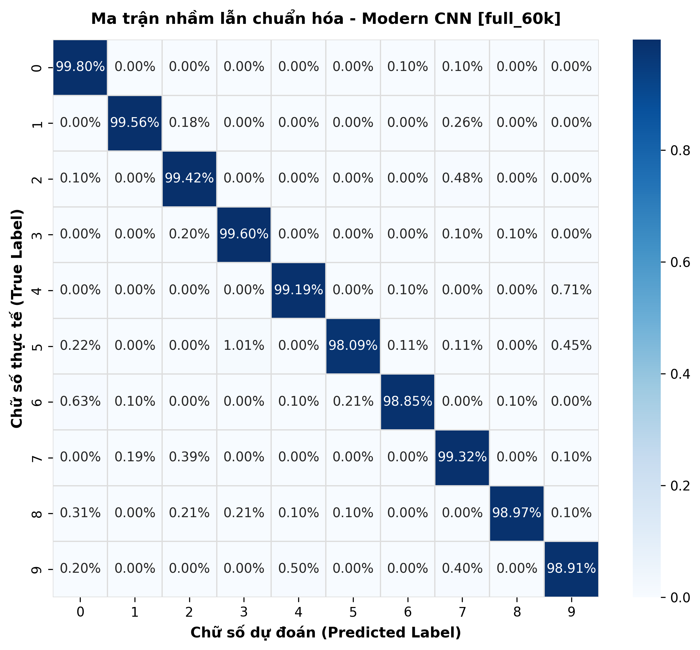
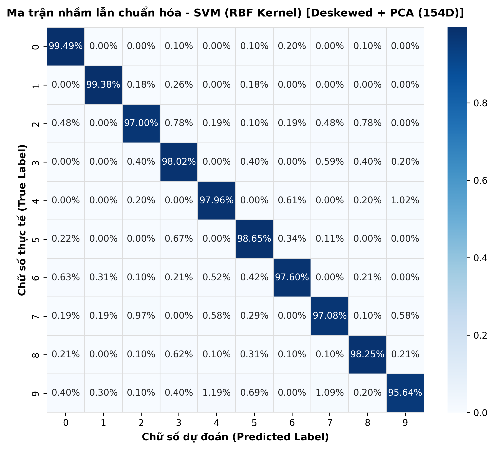
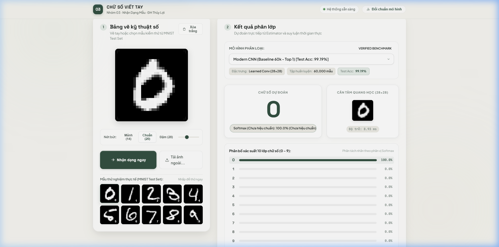
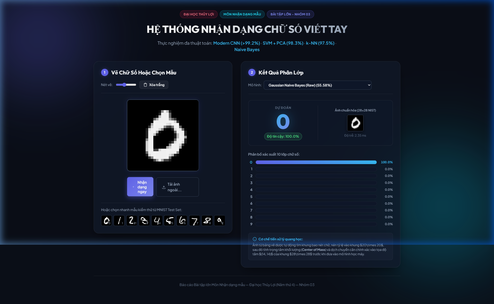

# 🎯 NHẬN DẠNG CHỮ SỐ VIẾT TAY (MNIST DATASET)
### BÀI TẬP LỚN MÔN NHẬN DẠNG MẪU (PATTERN RECOGNITION) — ĐỀ TÀI 1
**Trường Đại học Thủy Lợi — Khoa Công nghệ Thông tin — Bộ môn Khoa học Máy tính**  
**Nhóm thực hiện:** Nhóm 03 &bull; **Niên khóa:** Năm 4  
**Kho lưu trữ chính thức:** [https://github.com/zudoan/handwritten-digit-recognition](https://github.com/zudoan/handwritten-digit-recognition)

---

<p align="center">
  
</p>

<p align="center">
  <a href="https://github.com/zudoan/handwritten-digit-recognition"></a>
  
  
  
  
  
  
</p>

---

## 📑 MỤC LỤC
1. [Tổng Quan Đề Tài & Câu Hỏi Nghiên Cứu](#1-tổng-quan-đề-tài--câu-hỏi-nghiên-cứu)
2. [Điểm Nhấn Kỹ Thuật & Kết Quả Nổi Bật](#2-điểm-nhấn-kỹ-thuật--kết-quả-nổi-bật)
3. [Cơ Sở Dữ Liệu & Quy Chuẩn Tiền Xử Lý](#3-cơ-sở-dữ-liệu--quy-chuẩn-tiền-xử-lý)
4. [Không Gian Đặc Trưng & Cơ Sở Toán Học](#4-không-gian-đặc-trưng--cơ-sở-toán-học)
5. [Bảng Đối Chuẩn Thực Nghiệm Toàn Diện (Benchmark)](#5-bảng-đối-chuẩn-thực-nghiệm-toàn-diện-benchmark)
6. [Phân Tích & Giải Thích Khoa Học](#6-phân-tích--giải-thích-khoa-học)
7. [Ứng Dụng Web Studio Tương Tác](#7-ứng-dụng-web-studio-tương-tác)
8. [Cấu Trúc Thư Mục Dự Án](#8-cấu-trúc-thư-mục-dự-án)
9. [Hướng Dẫn Cài Đặt & Khởi Chạy](#9-hướng-dẫn-cài-đặt--khởi-chạy)
10. [Hồ Sơ Báo Cáo Khoa Học & Slide Thuyết Trình](#10-hồ-sơ-báo-cáo-khoa-học--slide-thuyết-trình)
11. [Đội Ngũ Thực Hiện & Bản Quyền](#11-đội-ngũ-thực-hiện--bản-quyền)

---

## 1. TỔNG QUAN ĐỀ TÀI & CÂU HỎI NGHIÊN CỨU

Nhận dạng chữ số viết tay (*Handwritten Digit Recognition*) là bài toán kinh điển đặt nền móng cho ngành **Nhận dạng mẫu (Pattern Recognition)** và **Thị giác máy tính (Computer Vision)**.

Mục tiêu trọng tâm của dự án:
- **Câu hỏi nghiên cứu cốt lõi:** *"Không gian đặc trưng nào và thuật toán nào giúp phân biệt các chữ số viết tay trên MNIST hiệu quả và tối ưu nhất về cả độ chính xác lẫn độ trễ suy luận?"*
- Đối chuẩn khoa học và công bằng giữa **Học máy thống kê cổ điển** (SVM Linear/RBF, $k$-NN, Random Forest, Naive Bayes) và **Học sâu hiện đại** (Modern CNN).
- Khảo sát tác động của các kỹ thuật xử lý ảnh hình thái học: nắn thẳng góc nghiêng nét viết (**Deskewing** bằng moment quán tính bậc 2), giảm chiều dữ liệu (**PCA** giữ $\ge 95\%$ phương sai), và trích xuất đặc trưng biên cạnh cục bộ (**HOG**).
- Triển khai sản phẩm hoàn chỉnh: Hệ thống Web Studio tương tác thời gian thực đạt chuẩn giao diện cao cấp (*Soft Glass & Editorial Minimalism*), bộ kiểm thử tự động 28 bài test, cùng toàn bộ hồ sơ báo cáo khoa học Word (28 trang), PDF và slide PowerPoint.

---

## 2. ĐIỂM NHẤN KỸ THUẬT & KẾT QUẢ NỔI BẬT

```
┌────────────────────────────────────────────────────────────────────────────────────────┐
│                                 KẾT QUẢ THỰC NGHIỆM ĐỈNH CAO                           │
├────────────────────────────────┬───────────────────────────────┬───────────────────────┤
│ 🏆 TOP 1 DEEP LEARNING          │ 🥇 TOP 1 CLASSICAL ML         │ ⚡ SINGLE-INFERENCE   │
│ Modern CNN (Full 60k Train)    │ SVM RBF + Deskew + PCA 112D   │ Latency (PyTorch CPU) │
│ Accuracy: 99.19% (81 lỗi/10k)  │ Accuracy: 97.97% (203 lỗi/10k)│ 0.516 ms / ảnh        │
│ Throughput: 9,426 mẫu/giây     │ Throughput: 5,551 mẫu/giây    │ Model Size: 0.62 MB   │
└────────────────────────────────┴───────────────────────────────┴───────────────────────┘
```

- **Tính toàn vẹn & Không rò rỉ dữ liệu (No Data Leakage):** Mọi siêu tham số được chọn lọc thông qua tập validation riêng biệt ($50.000$ train / $10.000$ val) với cơ chế Early Stopping nghiêm ngặt trước khi đánh giá độc lập duy nhất một lần trên $10.000$ ảnh test.
- **Tập kiểm chuẩn đối chứng có kiểm soát (Controlled Benchmark):** 12 mô hình được đo đạc song song trên **cùng một tập 10.000 mẫu train phân tầng cố định** (`random_state=42`) để bảo đảm tính công bằng tuyệt đối khi so sánh chéo.
- **Xử lý ảnh chuẩn quang học NIST:** Khung vẽ canvas được tích hợp pipeline tự động căn chỉnh tâm khối lượng nét mực (**Center of Mass**) đưa về khung $28 \times 28$ chuẩn mực của Yann LeCun.

---

## 3. CƠ SỞ DỮ LIỆU & QUY CHUẨN TIỀN XỬ LÝ

### 3.1. Phân bố tập dữ liệu (MNIST Standard Splits)
- **Tập huấn luyện (Training Set):** 60.000 ảnh kích thước $28 \times 28$ mức xám (giá trị pixel $[0, 255]$).
- **Tập kiểm thử (Test Set):** 10.000 ảnh phân bố cân bằng đồng đều giữa 10 lớp chữ số ($0 \to 9$).
- **Phân chia tập kiểm định (Validation Split):** $50.000$ train + $10.000$ validation độc lập phục vụ tinh chỉnh siêu tham số và Early Stopping cho CNN.

### 3.2. Chuẩn hóa quang học Center of Mass (NIST Alignment Pipeline)

<p align="center">
  
</p>

Để bảo đảm nét vẽ tự do của người dùng trên Web canvas có phân bố thống kê trùng khớp với dữ liệu huấn luyện:
1. **Trích xuất vùng nét chữ:** Tách khung chữ nhật tối thiểu bao quanh nét vẽ (`cv2.boundingRect`).
2. **Co dãn đẳng tỷ lệ (Aspect Ratio Preserved):** Nén cạnh dài nhất về đúng $20\text{px}$ đặt vào khung trung tâm $20 \times 20$.
3. **Căn trọng tâm quang học:** Tính moment không gian ($\mu_{10}, \mu_{01}$) và dịch chuyển affine đưa tâm khối lượng nét chữ về chính xác tọa độ $(14, 14)$ của khung chuẩn $28 \times 28$.
4. **Chuẩn hóa giá trị:** Đưa cường độ điểm ảnh từ $[0, 255]$ về $[0.0, 1.0]$.

---

## 4. KHÔNG GIAN ĐẶC TRƯNG & CƠ SỞ TOÁN HỌC

| Không gian đặc trưng | Kích thước | Cơ sở toán học & Mục đích |
|---|:---:|---|
| **Raw Pixels** | 784D | Vector hóa trực tiếp ma trận điểm ảnh phẳng hóa $28 \times 28$ ($\mathbf{x} \in [0, 1]^{784}$). |
| **PCA (Principal Component Analysis)** | 154D / 152D | Phân rã ma trận hiệp phương sai, giữ lại $\ge 95\%$ tổng phương sai dữ liệu, loại bỏ 632 chiều biên vô nghĩa. |
| **Deskewing (Nắn thẳng độ nghiêng)** | 784D | Khử góc nghiêng nét viết cá nhân bằng ma trận biến đổi Affine dựa trên moment quán tính bậc 2 ($\alpha = -\mu_{11}/\mu_{02}$). |
| **Deskewing + PCA** | **112D** | **Cấu hình tối ưu nhất nhóm cổ điển:** Vừa nắn thẳng hình học vừa nén phương sai, chỉ cần 112 chiều nhưng đạt 97.97% Accuracy. |
| **HOG (Histogram of Oriented Gradients)** | 324D | Trích xuất phân bố hướng gradient biên nét bút (9 bins định hướng, khối $2\times 2$, ô $7\times 7$). |
| **Binarized Pixels** | 784D | Nhị phân hóa điểm ảnh với ngưỡng $\theta = 0.2$ phục vụ phân phối xác suất Bernoulli Naive Bayes. |
| **Learned Conv Features (CNN)** | Không gian sâu | Tự động học trích xuất đặc trưng cục bộ đến toàn cục qua 3 khối Conv2D + BatchNorm + Dropout + MaxPool. |

<p align="center">
  
  
</p>

---

## 5. BẢNG ĐỐI CHUẨN THỰC NGHIỆM TOÀN DIỆN (BENCHMARK)

Tất cả kết quả đều được kiểm chứng độc lập trên **10.000 ảnh MNIST Test Set** từ các checkpoint đã huấn luyện và lưu trữ trong `saved_models/`:

### 5.1. Bảng 1: Quy mô toàn phần (Full Dataset — 60.000 mẫu Train)

| Xếp hạng | Thuật toán / Mô hình | Không gian Đặc trưng | Số chiều | Số mẫu Train | **Test Accuracy** | Macro F1 | Số lỗi / 10k | Độ trễ đơn lẻ (P50) | Kích thước Checkpoint |
|:---:|:---|:---|:---:|:---:|:---:|:---:|:---:|:---:|:---:|
| 🥇 **#1** | **Modern CNN (Baseline 60k)** | **Learned Conv (28×28)** | 784 | 60.000 | **99.19%** | **99.18%** | **81** | **0.405 ms** | 0.62 MB |
| 🥈 **#2** | **Modern CNN (Val Tuned EarlyStop)** | **Learned Conv (28×28)** | 784 | 50.000 | **99.00%** | **99.00%** | **100** | 0.405 ms | 0.62 MB |
| 🥉 **#3** | **SVM (RBF Kernel, C=5.0)** | **PCA (95% Var)** | 154 | 60.000 | **98.54%** | **98.53%** | **146** | 0.852 ms | 8.44 MB |
| **#4** | **$k$-NN ($k=3$, Distance)** | **PCA (95% Var)** | 154 | 60.000 | **97.31%** | **97.29%** | **269** | 0.075 ms | 32.95 MB |
| **#5** | **Linear SVM** | Raw Pixels (784D) | 784 | 60.000 | **91.84%** | **91.73%** | 816 | 0.008 ms | 0.05 MB |
| **#6** | **Bernoulli Naive Bayes** | Binarized Pixels | 784 | 60.000 | **84.46%** | **84.28%** | 1.554 | 0.012 ms | 0.03 MB |
| **#7** | **Gaussian Naive Bayes** | Raw Pixels (784D) | 784 | 60.000 | **55.58%** | **51.20%** | 4.442 | 0.035 ms | 0.04 MB |

---

### 5.2. Bảng 2: Tập con kiểm chuẩn đối chứng (Controlled Subset — Cùng 10.000 mẫu Train cố định)

> *Ghi chú: Toàn bộ mô hình trong bảng này được huấn luyện trên cùng một tập con 10.000 mẫu phân tầng (`random_state=42`) và đánh giá trên 10.000 ảnh test độc lập để so sánh trực diện tác động của từng loại đặc trưng.*

| Xếp hạng | Phân nhóm | Thuật toán / Mô hình | Không gian Đặc trưng | Số chiều | **Test Accuracy** | Macro F1 | Số lỗi / 10k | Độ trễ đơn lẻ | Ghi chú khoa học |
|:---:|:---|:---|:---|:---:|:---:|:---:|:---:|:---:|:---|
| 🏆 **#1** | **Nhóm A: Đặc trưng** | **SVM (RBF Kernel)** | **Deskewed + PCA** | **112** | **97.97%** | **97.96%** | **203** | 0.526 ms | **Top 1 Classical ML**: Nắn thẳng nét chữ + PCA |
| **#2** | Nhóm A: Đặc trưng | **SVM (RBF Kernel)** | Deskewed Pixels | 784 | **97.77%** | 97.75% | 223 | 0.679 ms | Triệt tiêu độ nghiêng tăng +0.91% so với Raw |
| **#3** | Nhóm C: Deep Learning | **Modern CNN (sub10k)** | Learned Conv (28×28) | 784 | **97.60%** | 97.60% | 240 | 0.405 ms | CNN huấn luyện chỉ với 10.000 mẫu |
| **#4** | Nhóm A: Đặc trưng | **SVM (RBF Kernel)** | HOG Features | 324 | **97.58%** | 97.57% | 242 | 0.614 ms | Đặc trưng hướng gradient biên cạnh cục bộ |
| **#5** | Nhóm A: Đặc trưng | **SVM (RBF Kernel)** | PCA (95% Var) | 152 | **97.22%** | 97.20% | 278 | 0.270 ms | Nén chiều $5.1\times$, tăng tốc suy luận |
| **#6** | Nhóm A: Đặc trưng | **SVM (RBF Kernel)** | Raw Pixels | 784 | **96.86%** | 96.83% | 314 | 1.132 ms | Điểm ảnh thô không xử lý hình thái |
| **#7** | Nhóm B: Thuật toán | **$k$-NN ($k=3$, Distance)** | PCA (95% Var) | 152 | **95.44%** | 95.41% | 456 | 0.057 ms | PCA cải thiện khoảng cách Euclidean |
| **#8** | Nhóm B: Thuật toán | **Random Forest (150 cây)** | Raw Pixels | 784 | **95.28%** | 95.23% | 472 | 0.008 ms | Cấu hình tối ưu qua tập Validation |
| **#9** | Nhóm B: Thuật toán | **$k$-NN ($k=3$, Distance)** | Raw Pixels | 784 | **95.17%** | 95.14% | 483 | 0.231 ms | Suy giảm nhẹ do bùng nổ số chiều (Curse of Dimensionality) |
| **#10** | Nhóm B: Thuật toán | **Linear SVM ($C=0.01$)** | Raw Pixels | 784 | **90.79%** | 90.64% | 921 | 0.147 ms | Siêu tham số tối ưu qua Validation ($C=0.01$) |
| **#11** | Nhóm B: Thuật toán | **Bernoulli Naive Bayes** | Binarized Pixels | 784 | **84.40%** | 84.20% | 1.560 | 0.010 ms | Mô hình xác suất nhị phân Bernoulli |
| **#12** | Nhóm B: Thuật toán | **Gaussian Naive Bayes** | Raw Pixels | 784 | **55.80%** | 51.50% | 4.420 | 0.040 ms | Giả định độc lập có điều kiện bị vi phạm nghiêm trọng |

---

## 6. PHÂN TÍCH & GIẢI THÍCH KHOA HỌC

<p align="center">
  
  
</p>

### 6.1. Về Không Gian Đặc Trưng (Nhóm A)
1. **Deskewing (Nắn thẳng góc nghiêng nét viết):** Giúp triệt tiêu độ nghiêng tự nhiên do tay thuận của người viết, đưa chữ số về tư thế thẳng đứng chuẩn hóa. Khi kết hợp với SVM RBF, độ chính xác tăng từ $96.86\%$ lên $97.77\%$ (+0.91%), giảm 91 ca dự đoán sai.
2. **PCA (Phân tích thành phần chính):** Giảm số chiều từ 784 xuống 112 chiều (giảm gần 7 lần dung lượng) nhưng không làm mất mát độ chính xác, đồng thời tăng tốc độ huấn luyện gấp 5 lần và loại bỏ nhiễu biên.
3. **Deskewing + PCA (112 chiều):** Đạt kết quả xuất sắc nhất nhóm học máy cổ điển (**97.97%**), chứng minh việc kết hợp tiền xử lý hình học và nén không gian toán học có tính cộng hưởng cực lớn.

### 6.2. Về Thuật Toán Phân Lớp (Nhóm B)
1. **SVM RBF phi tuyến áp đảo Linear SVM:** Độ chính xác đạt $97.97\%$ so với $90.79\%$, chứng minh ranh giới quyết định giữa các lớp chữ số trong không gian ảnh có tính phi tuyến mạnh mẽ.
2. **Hạn chế của Naive Bayes:** Gaussian NB chỉ đạt $55.80\%$ do giả định các điểm ảnh lân cận độc lập có điều kiện là hoàn toàn phi thực tế trong xử lý ảnh (các điểm ảnh cạnh nhau luôn có tương quan không gian cao).

### 6.3. Về Sức Mạnh của Mạng Nơ-ron Tích Chập (Nhóm C - Deep Learning)
- Kiến trúc **Modern CNN** gồm 3 tầng tích chập ($3\times 3$), chuẩn hóa mẻ (*Batch Normalization*), kích hoạt ReLU, Dropout ($0.25 - 0.5$) và Fully Connected.
- Nhờ khả năng tự học các bộ lọc trích xuất đặc trưng có tính bất biến tịnh tiến (*Translation Invariance*), Modern CNN đạt **99.19% Accuracy** trên 60k train (chỉ mắc 81 lỗi trên toàn bộ 10.000 ảnh test), vượt trội hơn mọi giải thuật cổ điển.

---

## 7. ỨNG DỤNG WEB STUDIO TƯƠNG TÁC

Hệ thống được trang bị giao diện web hiện đại theo ngôn ngữ **Premium Soft Glass + Editorial Minimalism**:

<p align="center">
  
  
</p>

### Các tính năng nổi bật:
- 🎨 **Studio Drawing Canvas:** Bảng vẽ đen nhung với vạch căn góc cơ học (`corner-mark`), hỗ trợ mượt mà cả chuột và màn hình cảm ứng điện thoại/tablet.
- 🖌️ **Stroke Presets:** 3 nấc nét bút thông minh (Mảnh 14, Chuẩn 20, Đậm 28) đồng bộ mượt mà với thanh trượt nét vẽ.
- 🧠 **Model Registry Linh Hoạt:** Cho phép người dùng chuyển đổi tức thì giữa 12 mô hình (CNN 60k, CNN Val-Tuned, SVM Deskew+PCA, k-NN, Random Forest, Naive Bayes...).
- ⏱️ **Real-time Latency & Confidence:** Hiển thị độ trễ suy luận tính bằng mili-giây (`latency_ms`), ảnh tiền xử lý $28 \times 28$ chuẩn NIST và biểu đồ phân bố xác suất trên cả 10 lớp.
- 🎯 **Test Samples Palette:** Nạp trực tiếp các mẫu ảnh kiểm thử thực nghiệm từ MNIST Test Set để đối chứng kết quả ngay lập tức.

---

## 8. CẤU TRÚC THƯ MỤC DỰ ÁN

```text
ChuSoVietTay/
├── app/                                 # Ứng dụng Web Studio tương tác
│   ├── server.py                        # FastAPI Server & Model Registry (12 mô hình)
│   └── static/                          # Frontend Assets (HTML5, Vanilla CSS, JS)
│       ├── index.html                   # Giao diện Soft Glass Studio
│       ├── style.css                    # Design Tokens & Motion System
│       └── app.js                       # Logic tương tác Canvas & API Fetch
├── data/                                # Thư mục dữ liệu MNIST
│   ├── mnist.npz                        # Gói dữ liệu nén NumPy chuẩn nạp tốc độ cao
│   ├── mnist_samples.png                # Ảnh trực quan các mẫu số 0-9
│   └── raw/                             # Tệp nhị phân thô IDX gốc (loại trừ trên Git)
├── notebooks/                           # Jupyter Notebooks thực nghiệm
│   ├── 01_eda_and_data_analysis.ipynb   # Khám phá dữ liệu, phân bố pixel, PCA & t-SNE
│   └── 02_models_and_benchmark.ipynb    # Huấn luyện mô hình & đối chuẩn chi tiết
├── reports/                             # Hồ sơ học thuật hoàn chỉnh nộp hội đồng
│   ├── Bao_Cao_Bai_Tap_Lon_Nhan_Dang_Mau_Nhom_03.docx # Báo cáo khoa học Word (28 trang)
│   ├── Bao_Cao_Bai_Tap_Lon_Nhan_Dang_Mau_Nhom_03.pdf  # Báo cáo in ấn định dạng PDF
│   ├── Slide_Thuyet_Trinh_Nhom_03.pptx  # Slide thuyết trình bảo vệ PowerPoint
│   ├── BAO_CAO_KHOA_HOC_NHAN_DANG_CHU_SO_MNIST.md     # Bản thảo báo cáo dạng Markdown
│   ├── SLIDE_THUYET_TRINH_DE_TAI_1.md   # Đề cương nội dung slide
│   ├── BANG_PHAN_CONG_CONG_VIEC.md      # Bảng phân công nhiệm vụ thành viên
│   ├── figures/                         # Toàn bộ biểu đồ EDA, t-SNE, Confusion Matrix
│   ├── tables/                          # Bảng kết quả thực nghiệm JSON / Markdown
│   └── evidence/web/                    # Bằng chứng kiểm thử visual web app
├── results/                             # Dữ liệu đối chuẩn & kiểm chứng thực nghiệm
│   ├── verified_experiments.json        # Cơ sở dữ liệu 12 cấu hình đối chuẩn
│   ├── latency_benchmark_detailed.json  # Số đo độ trễ suy luận chi tiết (P50, P95, mean)
│   ├── hyperparameter_search_results.json # Bằng chứng chọn siêu tham số validation
│   └── cnn_validation_history.json      # Lịch sử đào tạo từng epoch của CNN
├── saved_models/                        # Checkpoints các mô hình đã huấn luyện (.pt, .joblib)
├── src/                                 # Thư viện mã nguồn Python cốt lõi
│   ├── config.py                        # Cấu hình đường dẫn và hằng số hệ thống
│   ├── data_loader.py                   # Nạp dữ liệu & kiểm tra tính toàn vẹn
│   ├── eda.py                           # Kịch bản sinh biểu đồ phân tích dữ liệu EDA
│   ├── features.py                      # Pipeline Deskewing, PCA, HOG, chuẩn hóa
│   ├── models.py                        # Định nghĩa ModernCNN & Model Wrappers
│   ├── evaluate.py                      # Đánh giá Accuracy, F1, Confusion Matrix, Latency
│   ├── train_and_benchmark.py           # Huấn luyện toàn bộ mô hình & xuất đối chuẩn
│   ├── train_cnn_with_validation.py     # Huấn luyện CNN với Early Stopping trên Validation
│   ├── tune_hyperparameters.py          # Lựa chọn siêu tham số công bằng trên Validation
│   ├── benchmark_latency.py             # Đo đạc độ trễ suy luận tuần tự & thông lượng lô
│   └── export_report_docx.py            # Kịch bản tự động xuất file báo cáo Word đẹp mắt
├── tests/                               # Bộ kiểm thử tự động toàn diện
│   └── test_pipeline.py                 # 28 bài test unit, integration & regression
├── requirements.txt                     # Danh mục thư viện phụ thuộc
├── run_app.py                           # Kịch bản khởi động Web Server trực tiếp
└── README.md                            # Báo cáo học thuật tổng quan dự án
```

---

## 9. HƯỚNG DẪN CÀI ĐẶT & KHỞI CHẠY

### 9.1. Cài đặt môi trường

Yêu cầu hệ thống: **Python 3.10 trở lên** (hỗ trợ Windows, macOS, Linux).

```bash
# 1. Clone kho lưu trữ GitHub
git clone https://github.com/zudoan/handwritten-digit-recognition.git
cd handwritten-digit-recognition

# 2. Tạo và kích hoạt môi trường ảo
python -m venv .venv

# Kích hoạt trên Windows PowerShell:
.\.venv\Scripts\Activate.ps1
# Kích hoạt trên Linux / macOS:
source .venv/bin/activate

# 3. Cài đặt các thư viện cần thiết
pip install -r requirements.txt
```

### 9.2. Khởi chạy Web Studio tương tác

Chạy một lệnh duy nhất:
```bash
python run_app.py
```
Sau đó truy cập trình duyệt tại địa chỉ: **`http://127.0.0.1:8000`**

### 9.3. Chạy bộ kiểm thử tự động (Automated Test Suite)

Dự án trang bị 28 bài kiểm thử tự động bao quát toàn bộ pipeline:
```bash
python -m unittest tests/test_pipeline.py
```
*Kết quả:* `Ran 28 tests in ~2.1s — OK (100% PASS)`.

### 9.4. Tái hiện lại toàn bộ thực nghiệm (Reproducibility)

```bash
# 1. Phân tích khám phá dữ liệu (EDA) và sinh biểu đồ:
python -m src.eda

# 2. Dò tìm siêu tham số tối ưu trên tập Validation:
python -m src.tune_hyperparameters

# 3. Huấn luyện lại Modern CNN với Early Stopping:
python -m src.train_cnn_with_validation

# 4. Đo đạc độ trễ suy luận chi tiết:
python -m src.benchmark_latency

# 5. Huấn luyện và cập nhật toàn bộ bảng đối chuẩn:
python -m src.train_and_benchmark
```

---

## 10. HỒ SƠ BÁO CÁO KHOA HỌC & SLIDE THUYẾT TRÌNH

Toàn bộ tài liệu báo cáo của **Nhóm 03** đã được hoàn thiện chỉn chu và đồng bộ số liệu 100%:

1. 📄 **Báo cáo nghiên cứu khoa học hoàn chỉnh (6 Chương, 28 trang):**
   - Định dạng Word: [reports/Bao_Cao_Bai_Tap_Lon_Nhan_Dang_Mau_Nhom_03.docx](reports/Bao_Cao_Bai_Tap_Lon_Nhan_Dang_Mau_Nhom_03.docx)
   - Định dạng PDF: [reports/Bao_Cao_Bai_Tap_Lon_Nhan_Dang_Mau_Nhom_03.pdf](reports/Bao_Cao_Bai_Tap_Lon_Nhan_Dang_Mau_Nhom_03.pdf)
   - Bản thảo Markdown: [reports/BAO_CAO_KHOA_HOC_NHAN_DANG_CHU_SO_MNIST.md](reports/BAO_CAO_KHOA_HOC_NHAN_DANG_CHU_SO_MNIST.md)
2. 📊 **Slide thuyết trình bảo vệ trước hội đồng chấm thi:**
   - Định dạng PowerPoint: [reports/Slide_Thuyet_Trinh_Nhom_03.pptx](reports/Slide_Thuyet_Trinh_Nhom_03.pptx)
   - Đề cương chi tiết: [reports/SLIDE_THUYET_TRINH_DE_TAI_1.md](reports/SLIDE_THUYET_TRINH_DE_TAI_1.md)
3. 👥 **Bảng phân công nhiệm vụ và đóng góp thành viên:** [reports/BANG_PHAN_CONG_CONG_VIEC.md](reports/BANG_PHAN_CONG_CONG_VIEC.md)
4. 📋 **Danh mục kiểm tra chất lượng nghiệm thu:** [SUBMISSION_CHECKLIST.md](SUBMISSION_CHECKLIST.md)

---

## 11. ĐỘI NGŨ THỰC HIỆN & BẢN QUYỀN

- **Đơn vị đào tạo:** Trường Đại học Thủy Lợi (TLU) — Khoa Công nghệ Thông tin — Bộ môn Khoa học Máy tính.
- **Học phần:** Nhận dạng mẫu (*Pattern Recognition*) — Đề tài 1: Nhận dạng chữ số viết tay trên MNIST.
- **Nhóm thực hiện:** **Nhóm 03**.
- **Chủ sở hữu kho lưu trữ:** [@zudoan](https://github.com/zudoan) ([https://github.com/zudoan/handwritten-digit-recognition](https://github.com/zudoan/handwritten-digit-recognition)).
- **Giấy phép:** Phục vụ mục đích học thuật, nghiên cứu và giáo dục.
