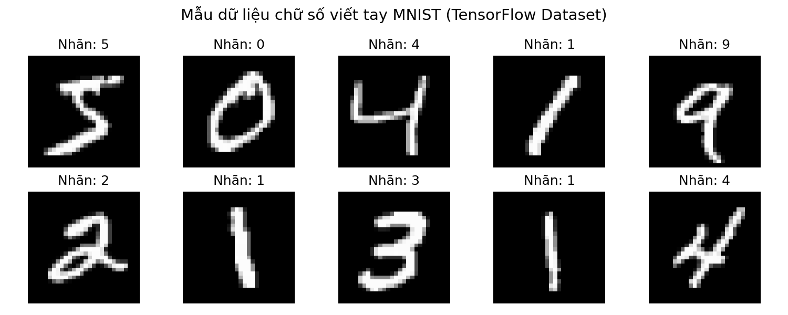

# BÁO CÁO DỮ LIỆU & ĐỀ TÀI: NHẬN DẠNG CHỮ SỐ VIẾT TAY (MNIST DATASET)
**HỌC PHẦN: NHẬN DẠNG MẪU (PATTERN RECOGNITION)**  
**TRƯỜNG ĐẠI HỌC THỦY LỢI - KHOA CÔNG NGHỆ THÔNG TIN**

---

<p align="center">
  
</p>

<p align="center">
  
  
  
  
  
</p>

---

## THÔNG TIN CHUNG

- **Môn học**: Nhận dạng mẫu (*Pattern Recognition*)
- **Khóa học / Niên khóa**: Đại học chính quy (Năm thứ 4)
- **Đề tài**: Nghiên cứu và triển khai các giải thuật nhận dạng mẫu trên bộ dữ liệu chữ số viết tay MNIST
- **Sinh viên thực hiện**: `[Điền Họ và Tên sinh viên]`
- **Mã số sinh viên (MSV)**: `[Điền Mã sinh viên]`
- **Lớp**: `[Điền Tên lớp, ví dụ: 63KTPM...]`
- **Giảng viên hướng dẫn**: `[Điền Tên Giảng viên hướng dẫn]`

---

## MỤC LỤC
1. [Giới Thiệu Đề Tài](#1-giới-thiệu-đề-tài)
2. [Cơ Sở Khoa Học Về Bộ Dữ Liệu MNIST](#2-cơ-sở-khoa-học-về-bộ-dữ-liệu-mnist)
3. [Cấu Trúc Không Gian Dữ Liệu & Biểu Diễn Toán Học](#3-cấu-trúc-không-gian-dữ-liệu--biểu-diễn-toán-học)
4. [Cấu Trúc Thư Mục Dự Án](#4-cấu-trúc-thư-mục-dự-án)
5. [Quy Trình Tải & Quản Lý Dữ Liệu](#5-quy-trình-tải--quản-lý-dữ-liệu)
6. [Pipeline Nạp & Tiền Xử Lý Dữ Liệu](#6-pipeline-nạp--tiền-xử-lý-dữ-liệu)
7. [Định Hướng Giải Thuật & Tiêu Chí Đánh Giá](#7-định-hướng-giải-thuật--tiêu-chí-đánh-giá)
8. [Tài Liệu Tham Khảo](#8-tài-liệu-tham-khảo)

---

## 1. GIỚI THIỆU ĐỀ TÀI

Nhận dạng chữ số viết tay (*Handwritten Digit Recognition*) là một trong những bài toán kinh điển đặt nền móng cho ngành Nhận dạng mẫu (*Pattern Recognition*) và Thị giác máy tính (*Computer Vision*). Mục tiêu trọng tâm của đề tài là xây dựng hệ thống tự động phân loại các ảnh xám chứa chữ số viết tay đơn lẻ vào một trong 10 lớp tương ứng từ $0$ đến $9$.

Nghiên cứu tập trung giải quyết các thách thức kỹ thuật:
- Sự biến thiên lớn về hình học: nét chữ, góc nghiêng, nét đậm/nhạt, kích thước phụ thuộc vào thói quen viết tay của từng cá nhân.
- Khả năng trích xuất đặc trưng có tính phân lớp cao (*discriminative features*).
- Đánh giá và so sánh hiệu năng giữa các trường phái tiếp cận: **Học máy truyền thống** (*Statistical Pattern Recognition*) và **Mạng nơ-ron sâu** (*Deep Learning*).

---

## 2. CƠ SỞ KHOA HỌC VỀ BỘ DỮ LIỆU MNIST

Bộ dữ liệu **MNIST** (*Modified National Institute of Standards and Technology database*) được thiết kế và công bố bởi Yann LeCun, Corinna Cortes và Christopher J.C. Burges. Trong đề tài này, dữ liệu được tải và chuẩn hóa trực tiếp từ nguồn chính thức của **TensorFlow Datasets Catalog**:
- **TensorFlow Catalog URL**: [tensorflow.org/datasets/catalog/mnist](https://www.tensorflow.org/datasets/catalog/mnist)
- **Official Mirror**: [Google Cloud Storage (CVDF Mirror)](https://storage.googleapis.com/cvdf-datasets/mnist/)

### 2.1. Phân bố dữ liệu (Splits)

Bộ dữ liệu chuẩn gồm **70,000** mẫu đã được tiền chuẩn hóa và phân chia độc lập nhằm đảm bảo tính khách quan trong kiểm thử học thuật:

| Phân vùng dữ liệu | Số lượng mẫu | Tỷ lệ (%) | Mục đích sử dụng |
| :--- | :---: | :---: | :--- |
| **Training Set** (`x_train`, `y_train`) | 60,000 | ~85.7% | Huấn luyện mô hình, tối ưu tham số và trọng số |
| **Test Set** (`x_test`, `y_test`) | 10,000 | ~14.3% | Đánh giá khả năng tổng quát hóa (*Generalization*) |
| **Tổng cộng** | **70,000** | **100%** | Phân bố cân bằng đồng đều giữa 10 lớp ($0 \to 9$) |

### 2.2. Đặc tính hình ảnh & Chuẩn hóa sẵn có

- **Không gian ảnh**: Ảnh mức xám (*Grayscale Image*), kênh màu đơn ($C = 1$).
- **Độ phân giải**: $28 \times 28$ pixels (tương đương $784$ thuộc tính điểm ảnh).
- **Căn chỉnh quang học (*Preprocessing Standard*)**:
  - Từng chữ số gốc từ NIST được chuẩn hóa kích thước sao cho nằm vừa vặn trong khung viền $20 \times 20$ pixel mà vẫn giữ nguyên tỉ lệ khung hình (*Aspect Ratio*).
  - Trọng tâm khối lượng nét chữ (*Center of Mass*) được tính toán và dịch chuyển căn chính xác vào tâm khung hình $28 \times 28$.
  - Mức xám mỗi pixel là một số nguyên không dấu 8-bit ($\text{uint8} \in [0, 255]$), trong đó giá trị $0$ đại diện cho nền đen hoàn toàn và $255$ đại diện cho nét mực màu trắng.

---

## 3. CẤU TRÚC KHÔNG GIAN DỮ LIỆU & BIỂU DIỄN TOÁN HỌC

### 3.1. Biểu diễn toán học của không gian mẫu

Mỗi mẫu quan sát thứ $i$ trong tập dữ liệu được mô tả bởi một cặp $(\mathbf{X}^{(i)}, y^{(i)})$, trong đó:

1. **Ma trận không gian 2D** (dành cho mô hình tích chập CNN):
   $$\mathbf{X}^{(i)} \in \mathbb{R}^{28 \times 28}, \quad x_{r, c}^{(i)} \in \{0, 1, \dots, 255\}$$

2. **Vector đặc trưng 1D** (dành cho các giải thuật nhận dạng mẫu kinh điển như k-NN, SVM, MLP):
   $$\mathbf{x}^{(i)} = \text{vec}(\mathbf{X}^{(i)}) = \begin{bmatrix} x_1^{(i)} & x_2^{(i)} & \dots & x_{784}^{(i)} \end{bmatrix}^T \in \mathbb{R}^{784}$$

3. **Không gian nhãn lớp**:
   $$y^{(i)} \in \mathcal{Y} = \{0, 1, 2, 3, 4, 5, 6, 7, 8, 9\}$$
   Hoặc biểu diễn dưới dạng vector mã hóa One-Hot Encoding:
   $$\mathbf{y}^{(i)} \in \{0, 1\}^{10}, \quad \sum_{k=0}^{9} y_k^{(i)} = 1$$

---

## 4. CẤU TRÚC THƯ MỤC DỰ ÁN

Mã nguồn và tệp dữ liệu được tổ chức khoa học, tuân thủ tiêu chuẩn kỹ thuật phần mềm khoa học dữ liệu:

```text
ChuSoVietTay/
├── data/                                 # Thư mục lưu trữ bộ dữ liệu thực nghiệm
│   ├── mnist.npz                         # Gói nén nhị phân NumPy (chuẩn nạp tốc độ cao)
│   ├── mnist_samples.png                 # Ảnh biểu diễn trực quan các mẫu đại diện
│   └── raw/                              # Dữ liệu gốc định dạng nhị phân IDX từ TFDS
│       ├── train-images-idx3-ubyte       # 60,000 ảnh huấn luyện (Byte thô giải nén)
│       ├── train-labels-idx1-ubyte       # 60,000 nhãn huấn luyện
│       ├── t10k-images-idx3-ubyte        # 10,000 ảnh kiểm thử
│       ├── t10k-labels-idx1-ubyte        # 10,000 nhãn kiểm thử
│       ├── train-images-idx3-ubyte.gz    # Tệp nén gốc từ máy chủ Google Cloud
│       ├── train-labels-idx1-ubyte.gz
│       ├── t10k-images-idx3-ubyte.gz
│       └── t10k-labels-idx1-ubyte.gz
├── download_mnist.py                     # Kịch bản tự động tải, giải nén và kiểm thử tính toàn vẹn
├── load_data.py                          # Module nạp, chuyển đổi và tiền xử lý dữ liệu
├── requirements.txt                      # Danh mục các gói thư viện phụ thuộc
├── .gitignore                            # Khai báo loại trừ các tệp nhị phân kích thước lớn
└── README.md                             # Báo cáo học thuật về bộ dữ liệu và đề tài
```

---

## 5. QUY TRÌNH TẢI & QUẢN LÝ DỮ LIỆU

### 5.1. Cài đặt môi trường thực thi

Hệ thống yêu cầu môi trường **Python 3.8+**. Để cài đặt đầy đủ các thư viện phụ trợ:

```bash
pip install -r requirements.txt
```

*Các thư viện nòng cốt*: `numpy`, `matplotlib`, `scikit-learn`.

### 5.2. Kịch bản tự động tải dữ liệu (`download_mnist.py`)

Kịch bản [download_mnist.py](file:///d:/Thuy_Loi/Nam_4/nhan_dang_mau/ChuSoVietTay/download_mnist.py) thực hiện quy trình tự động hóa hoàn chỉnh:
1. Kết nối với các kho lưu trữ phân phối chính thức của TensorFlow Datasets (CVDF mirror).
2. Tải song song cả tệp nhị phân thô (`.gz`) và tệp ma trận NumPy tối ưu (`mnist.npz`).
3. Tự động giải nén các tệp định dạng IDX.
4. Kiểm định tính toàn vẹn (*Checksum & Dimensionality Check*): Đảm bảo số chiều ma trận $(60000, 28, 28)$ và nhãn tương ứng $(60000,)$ không bị lỗi bit hay suy biến dữ liệu.
5. Tạo ảnh mẫu [mnist_samples.png](file:///d:/Thuy_Loi/Nam_4/nhan_dang_mau/ChuSoVietTay/data/mnist_samples.png) kiểm tra kết quả trực quan.

Để thực thi lại việc tải dữ liệu:
```bash
python download_mnist.py
```

---

## 6. PIPELINE NẠP & TIỀN XỬ LÝ DỮ LIỆU

Module [load_data.py](file:///d:/Thuy_Loi/Nam_4/nhan_dang_mau/ChuSoVietTay/load_data.py) cung cấp các giao diện lập trình (*API*) nhất quán, độc lập và tương thích với hầu hết các thư viện khoa học tính toán:

### 6.1. Đọc dữ liệu nhanh qua định dạng NumPy

```python
from load_data import load_mnist_npz

# Nạp trực tiếp bộ dữ liệu
(x_train, y_train), (x_test, y_test) = load_mnist_npz()

print(f"Kích thước tập huấn luyện: {x_train.shape}, Nhãn: {y_train.shape}")
print(f"Kích thước tập kiểm thử   : {x_test.shape},  Nhãn: {y_test.shape}")
```

### 6.2. Đọc trực tiếp từ tệp thô IDX (*IDX Binary Format*)

Dành cho nghiên cứu giải mã cấu trúc tệp nhị phân cấp thấp theo đặc tả của Yann LeCun:

```python
from load_data import load_mnist_raw

(x_train, y_train), (x_test, y_test) = load_mnist_raw()
```

### 6.3. Chuẩn hóa & Biến đổi không gian đặc trưng

Trước khi đưa vào mô hình học máy, dữ liệu cần trải qua các bước tiền xử lý toán học:

```python
import numpy as np
from load_data import load_mnist_npz

(x_train, y_train), (x_test, y_test) = load_mnist_npz()

# 1. Chuẩn hóa Min-Max Scaling về miền giá trị [0, 1]
x_train_norm = x_train.astype(np.float32) / 255.0
x_test_norm = x_test.astype(np.float32) / 255.0

# 2. Vector hóa thành vector 784 chiều (Phù hợp k-NN, SVM, Logistic Regression, MLP)
x_train_vec = x_train_norm.reshape(x_train.shape[0], -1)  # (60000, 784)
x_test_vec = x_test_norm.reshape(x_test.shape[0], -1)    # (10000, 784)

# 3. Mở rộng chiều kênh màu (Phù hợp mô hình Convolutional Neural Network - CNN)
x_train_cnn = np.expand_dims(x_train_norm, axis=-1)       # (60000, 28, 28, 1)
x_test_cnn = np.expand_dims(x_test_norm, axis=-1)         # (10000, 28, 28, 1)
```

---

## 7. ĐỊNH HƯỚNG GIẢI THUẬT & TIÊU CHÍ ĐÁNH GIÁ

### 7.1. Các phương pháp nhận dạng mẫu dự kiến thực nghiệm

Trong khuôn khổ môn học **Nhận dạng mẫu**, đề tài dự kiến triển khai và đánh giá so sánh thực nghiệm trên các nhóm giải thuật:

1. **Phương pháp Nhận dạng Mẫu Cổ điển (Non-parametric & Parametric Models)**:
   - **$k$-Láng giềng gần nhất ($k$-NN)**: Khảo sát khoảng cách Euclidean, Manhattan và ảnh hưởng của siêu tham số $k$.
   - **Máy vector hỗ trợ (Support Vector Machine - SVM)**: Khảo sát Kernel tuyến tính (Linear) và Kernel RBF.
   - **Bộ phân lớp Bayes thơ ngây (Gaussian / Multinomial Naive Bayes)**.
   - **Cây quyết định (Decision Tree) & Rừng ngẫu nhiên (Random Forest)**.

2. **Phương pháp Trích xuất & Giảm chiều Đặc trưng (Feature Extraction & Dimensionality Reduction)**:
   - **Phân tích thành phần chính (Principal Component Analysis - PCA)**: Nén không gian từ $784$ chiều xuống $d$ chiều thành phần chính tối ưu.
   - **Trích xuất đặc trưng biên cạnh / HOG (Histogram of Oriented Gradients)**.

3. **Phương pháp Tiếp cận Mạng nơ-ron (Neural Networks)**:
   - **Mạng Perceptron đa tầng (Multi-Layer Perceptron - MLP)**.
   - **Mạng nơ-ron tích chập (Convolutional Neural Network - CNN / LeNet-5 architecture)**.

### 7.2. Tiêu chí đánh giá khoa học (*Evaluation Metrics*)

Hiệu năng của các mô hình phân lớp được lượng hóa thông qua các chỉ số thống kê toán học:

1. **Độ chính xác toàn cục (*Accuracy*)**:
   $$\text{Accuracy} = \frac{\sum_{i=1}^{N} \mathbb{I}(\hat{y}^{(i)} = y^{(i)})}{N}$$

2. **Độ chính xác theo lớp (*Precision*) & Độ bao phủ (*Recall*)**:
   $$\text{Precision}_c = \frac{TP_c}{TP_c + FP_c}, \quad \text{Recall}_c = \frac{TP_c}{TP_c + FN_c}$$

3. **Chỉ số F1-Score điều hòa**:
   $$F_1\text{-Score}_c = 2 \times \frac{\text{Precision}_c \times \text{Recall}_c}{\text{Precision}_c + \text{Recall}_c}$$

4. **Ma trận nhầm lẫn (*Confusion Matrix*)**: Trực quan hóa sai số phân lớp chéo giữa các cặp chữ số dễ nhầm lẫn (ví dụ: cặp chữ số $4 - 9$, $3 - 5$, hoặc $7 - 1$).

---

## 8. TÀI LIỆU THAM KHẢO

1. **LeCun, Y., Bottou, L., Bengio, Y., & Haffner, P. (1998)**. *Gradient-based learning applied to document recognition*. Proceedings of the IEEE, 86(11), 2278-2324.
2. **TensorFlow Datasets Documentation**. *MNIST Dataset Catalog*. [https://www.tensorflow.org/datasets/catalog/mnist](https://www.tensorflow.org/datasets/catalog/mnist).
3. **Bishop, C. M. (2006)**. *Pattern Recognition and Machine Learning*. Springer New York.
4. **Duda, R. O., Hart, P. E., & Stork, D. G. (2001)**. *Pattern Classification* (2nd ed.). Wiley-Interscience.
5. **Giáo trình Nhận dạng mẫu**, Bộ môn Khoa học Máy tính & Công nghệ Thông tin, Trường Đại học Thủy Lợi.
