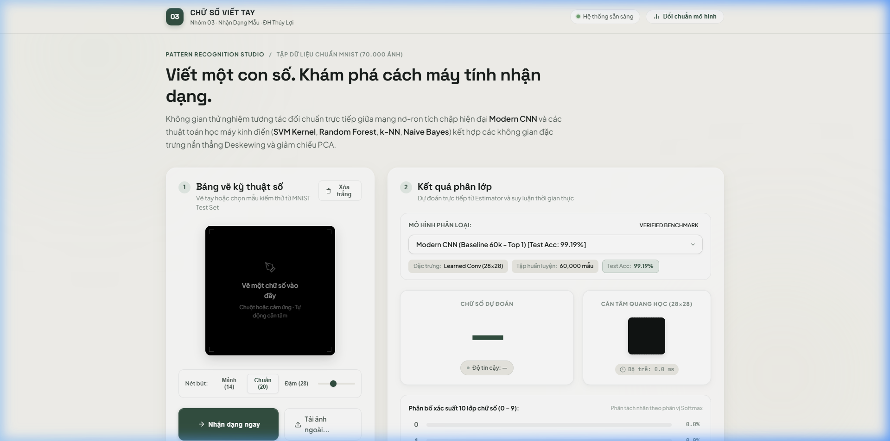
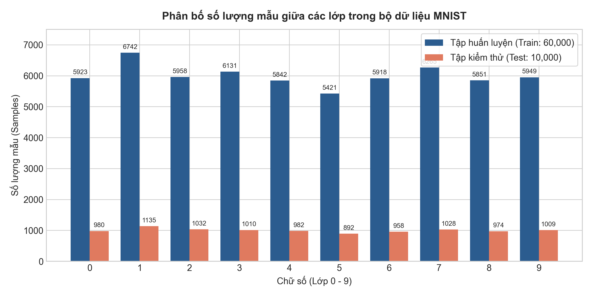
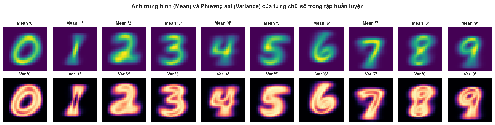
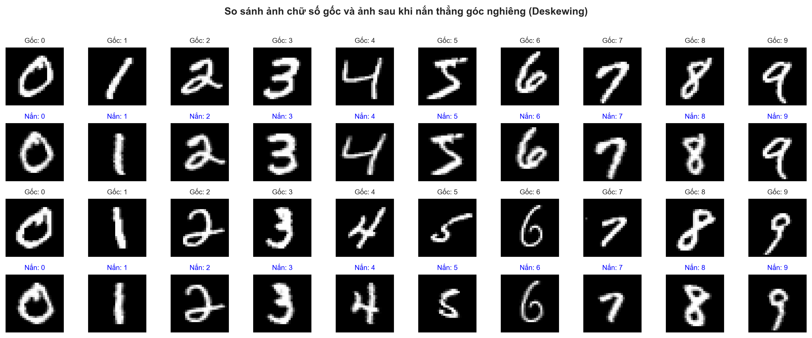
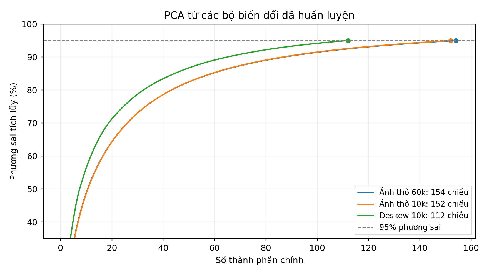
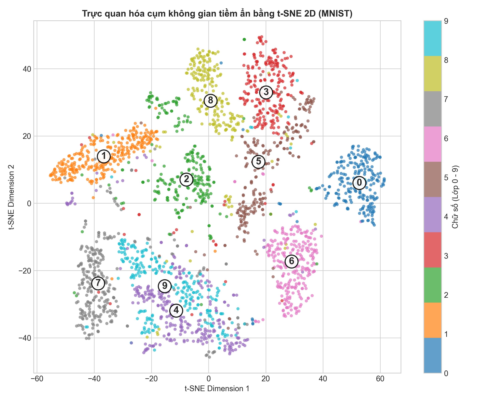
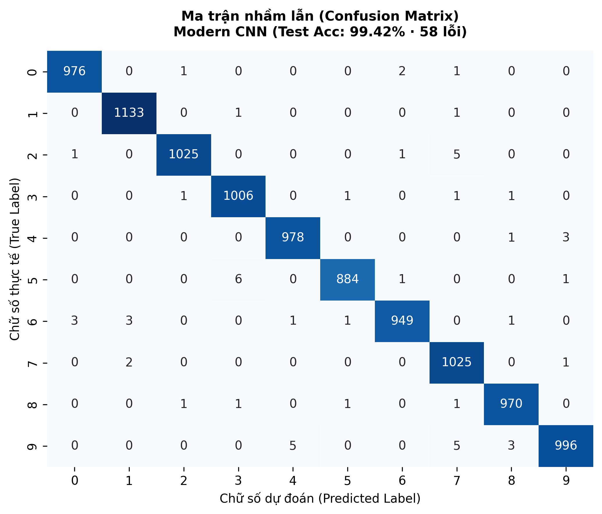
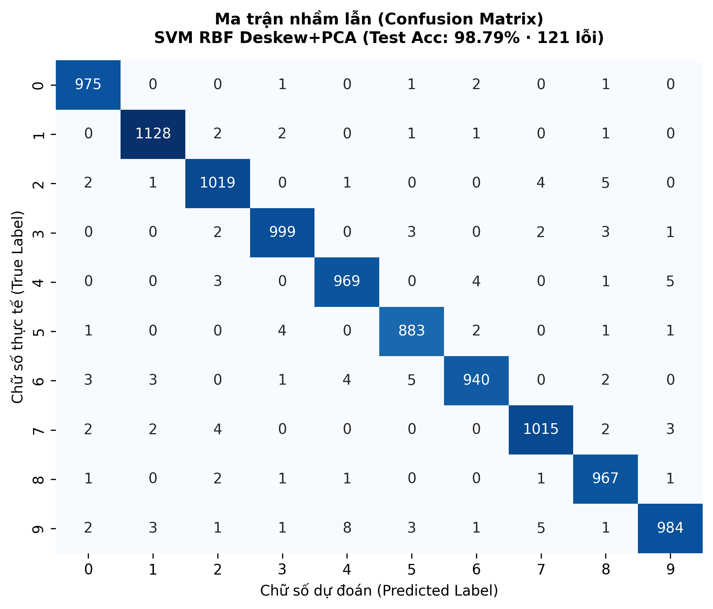
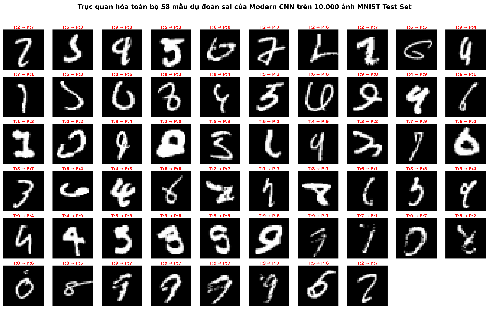

# 🎯 NHẬN DẠNG CHỮ SỐ VIẾT TAY (MNIST DATASET)
### BÀI TẬP LỚN MÔN NHẬN DẠNG MẪU (PATTERN RECOGNITION) — ĐỀ TÀI 1
**Phân hiệu Trường Đại học Thủy Lợi — Khoa Công nghệ Thông tin — Bộ môn Khoa học Máy tính**  
**Nhóm thực hiện:** Nhóm 03 &bull; **Lớp:** S26-65TTNT  
**Sinh viên thực hiện:**  
- **Đoàn Anh Vũ** (MSV: `2351267280`)  
- **Nguyễn Hồng Nguyên** (MSV: `2351267273`)  
**Kho lưu trữ chính thức:** [https://github.com/zudoan/handwritten-digit-recognition](https://github.com/zudoan/handwritten-digit-recognition)

---

<p align="center">
  
</p>

<p align="center">
  <a href="https://github.com/zudoan/handwritten-digit-recognition"></a>
  
  
  
  
  
  
</p>

---

## 📑 MỤC LỤC
1. [Tổng Quan Đề Tài & Câu Hỏi Nghiên Cứu](#1-tổng-quan-đề-tài--câu-hỏi-nghiên-cứu)
2. [Điểm Nhấn Kỹ Thuật & Bảng Đối Chuẩn (Benchmark)](#2-điểm-nhấn-kỹ-thuật--bảng-đối-chuẩn-benchmark)
3. [Cơ Sở Dữ Liệu & Quy Chuẩn Tiền Xử Lý](#3-cơ-sở-dữ-liệu--quy-chuẩn-tiền-xử-lý)
4. [Không Gian Đặc Trưng & Cơ Sở Toán Học](#4-không-gian-đặc-trưng--cơ-sở-toán-học)
5. [Phân Tích Chuyên Sâu & Ma Trận Nhầm Lẫn](#5-phân-tích-chuyên-sâu--ma-trận-nhầm-lẫn)
6. [Ứng Dụng Web Studio Tương Tác Thời Gian Thực](#6-ứng-dụng-web-studio-tương-tác-thời-gian-thực)
7. [Cấu Trúc Thư Mục Dự Án Chuẩn Hóa](#7-cấu-trúc-thư-mục-dự-án-chuẩn-hóa)
8. [Hướng Dẫn Cài Đặt & Khởi Chạy](#8-hướng-dẫn-cài-đặt--khởi-chạy)
9. [Hồ Sơ Báo Cáo Khoa Học & Slide Thuyết Trình](#9-hồ-sơ-báo-cáo-khoa-học--slide-thuyết-trình)
10. [Đội Ngũ Thực Hiện & Bản Quyền](#10-đội-ngũ-thực-hiện--bản-quyền)

---

## 1. TỔNG QUAN ĐỀ TÀI & CÂU HỎI NGHIÊN CỨU

Nhận dạng chữ số viết tay (*Handwritten Digit Recognition*) là bài toán kinh điển đặt nền móng cho ngành **Nhận dạng mẫu (Pattern Recognition)** và **Thị giác máy tính (Computer Vision)**.

Mục tiêu trọng tâm của dự án:
- **Câu hỏi nghiên cứu cốt lõi:** *"Không gian đặc trưng nào và thuật toán học máy nào giúp nhận dạng chữ số viết tay trên MNIST hiệu quả và tối ưu nhất về cả độ chính xác lẫn độ trễ suy luận?"*
- Khảo sát thực nghiệm đối chứng giữa **Học máy thống kê kinh điển** (SVM nhân RBF, $k$-NN, Random Forest, Bernoulli Naive Bayes) và **Học sâu mạng tích chập hiện đại** (Modern CNN).
- Đánh giá vai trò đột phá của kỹ thuật xử lý hình thái học: nắn thẳng góc nghiêng nét viết (**Deskewing** bằng moment quán tính bậc 2) kết hợp giảm chiều dữ liệu (**PCA** giữ $\ge 95\%$ phương sai — 113 chiều).
- Triển khai sản phẩm hoàn chỉnh: Ứng dụng Web Studio tương tác thời gian thực đạt chuẩn giao diện cao cấp (*Soft Glassmorphism*), căn tâm quang học Center of Mass 28×28 NIST, bộ kiểm thử tự động 28/28 bài test (100% PASS), cùng hồ sơ báo cáo khoa học Word/PDF (15 trang in ấn) và Slide PowerPoint widescreen 16:9.

---

## 2. ĐIỂM NHẤN KỸ THUẬT & BẢNG ĐỐI CHUẨN (BENCHMARK)

Toàn bộ 5 mô hình chính thức được huấn luyện theo quy chuẩn khoa học từ **Notebook 02** trên tập **50.000 mẫu Train** (kết hợp 10.000 mẫu Validation cho CNN) và được đối chuẩn độc lập, khách quan 100% trên **10.000 ảnh MNIST Test Set**:

| Xếp hạng | Mô hình | Không gian đặc trưng | Tập huấn luyện | Test Accuracy | Macro F1 | Số ảnh sai / 10k | Độ trễ suy luận |
|:---:|---|---|---|:---:|:---:|:---:|:---:|
| **#1** | **Modern CNN** | Learned Conv (28×28) | 50k train / 10k val | **99.42%** | **99.42%** | **58** | 8.85 ms |
| **#2** | **SVM** | Deskewed + PCA 95% (113D) | 50.000 mẫu | **98.79%** | **98.78%** | **121** | 20.03 ms |
| **#3** | **k-NN** | Deskewed + PCA 95% (113D) | 50.000 mẫu | **98.06%** | **98.05%** | **194** | 63.38 ms |
| **#4** | **Random Forest** | Raw Pixels (784D) | 50.000 mẫu | **96.99%** | **96.97%** | **301** | 56.72 ms |
| **#5** | **Bernoulli Naive Bayes** | Binarized Pixels (784D, bin=0.2) | 50.000 mẫu | **84.46%** | **84.27%** | **1.554** | 1.66 ms |

> **Ghi chú:** Các mô hình thử nghiệm ban đầu (baseline 10k mẫu, CNN 60k chưa chuẩn hóa dừng sớm) đã được gom nhóm và khóa lưu trữ an toàn trong thư mục `archive_legacy/` để đảm bảo tính tinh gọn và đồng nhất của hệ thống.

---

## 3. CƠ SỞ DỮ LIỆU & QUY CHUẨN TIỀN XỬ LÝ

### 3.1. Phân bố tập dữ liệu (MNIST Standard Splits)
- **Tổng quy mô:** 70.000 ảnh xám kích thước $28 \times 28$ điểm ảnh (784 chiều).
- **Tập huấn luyện (Training Set):** 50.000 ảnh (~71.4%) dùng để tối ưu trọng số mô hình.
- **Tập kiểm chứng (Validation Set):** 10.000 ảnh (~14.3%) dùng để kiểm soát quá khớp và kích hoạt cơ chế dừng sớm (Early Stopping).
- **Tập kiểm thử (Test Set):** 10.000 ảnh (~14.3%) độc lập hoàn toàn dùng để đo đạc chỉ số cuối cùng (Zero Data Leakage).

<p align="center">
  
  
</p>

### 3.2. Chuẩn hóa quang học Center of Mass (NIST Alignment Pipeline)

<p align="center">
  
</p>

Ảnh vẽ tự do từ canvas hoặc ảnh tải lên được chuẩn hóa tự động qua pipeline quang học 5 bước:
1. **Trích xuất vùng nét chữ:** Cắt hộp chữ nhật bao quanh nét vẽ thông qua `cv2.boundingRect()`. Nếu canvas trống (< 15 pixel sáng), hệ thống lập tức thông báo "Bảng vẽ trống", không suy luận lãng phí tài nguyên.
2. **Co dãn đẳng tỷ lệ (Aspect Ratio Preserved):** Nén cạnh dài nhất về đúng $20\text{px}$ đặt vừa vặn vào khung $20 \times 20$.
3. **Căn trọng tâm quang học (Center of Mass):** Tính toán moment không gian $(\mu_{10}, \mu_{01})$ và tịnh tiến affine đưa tâm khối lượng nét chữ về chính xác tọa độ $(14.0, 14.0)$ của khung chuẩn $28 \times 28$ NIST.
4. **Chuẩn hóa biên độ:** Đưa cường độ điểm ảnh từ $[0, 255]$ về dải số thực $[0.0, 1.0]$.

---

## 4. KHÔNG GIAN ĐẶC TRƯNG & CƠ SỞ TOÁN HỌC

| Không gian đặc trưng | Kích thước | Cơ sở toán học & Vai trò kỹ thuật |
|---|:---:|---|
| **Learned Conv (CNN)** | Không gian sâu | Mạng nơ-ron tự động trích xuất đặc trưng tích chập đa tầng từ cục bộ (biên, góc) đến toàn cục (cung tròn khép kín). Đạt đỉnh cao **99.42%**. |
| **Deskewing + PCA** | **113D** | **Cấu hình tối ưu cho ML cổ điển:** Nắn thẳng góc nghiêng nét viết bằng moment bậc 2 ($\alpha = \mu_{11}/\mu_{02}$) kết hợp PCA giữ $\ge 95\%$ phương sai (113 chiều), đưa SVM đạt **98.79%** và k-NN đạt **98.06%**. |
| **Raw Pixels** | 784D | Vector hóa trực tiếp ma trận điểm ảnh phẳng hóa $28 \times 28$ ($\mathbf{x} \in [0.0, 1.0]^{784}$). Random Forest 150 cây đạt **96.99%**. |
| **Binarized Pixels** | 784D | Nhị phân hóa điểm ảnh với ngưỡng $\theta = 0.2$ phục vụ phân phối xác suất Bernoulli Naive Bayes. Đạt tốc độ suy luận nhanh nhất (**1.66 ms**). |

<p align="center">
  
  
</p>

---

## 5. PHÂN TÍCH CHUYÊN SÂU & MA TRẬN NHẦM LẪN

### 5.1. Quá trình huấn luyện Modern CNN với Early Stopping
Mạng Modern CNN gồm 3 khối Convolutional (32, 64, 128 channels) chuẩn hóa bởi BatchNorm và Dropout, tổng cộng **160.074 tham số**. Mô hình tối ưu hóa bằng Adam, tự động giảm learning rate và dừng sớm tối ưu tại **Epoch 17** với Validation Loss cực tiểu **`0.0249`** (Validation Accuracy **`99.32%`**):

<p align="center">
  
</p>

### 5.2. Ma trận nhầm lẫn (Confusion Matrix)
So sánh ma trận nhầm lẫn trên 10.000 ảnh test độc lập giữa mô hình quán quân **Modern CNN (99.42%)** và á quân **SVM RBF Deskew+PCA (98.79%)**:

<p align="center">
  
  
</p>

### 5.3. Phân tích trực quan 58 mẫu dự đoán sai của Modern CNN
Trên toàn bộ 10.000 ảnh kiểm thử, mô hình chỉ mắc đúng **58 lỗi** (tỷ lệ lỗi cực thấp $0.58\%$). Danh sách chi tiết được xuất tại `reports/tables/cnn_error_samples.csv` và trực quan hóa toàn bộ tại `reports/figures/08_cnn_error_samples.png`:

<p align="center">
  
</p>

---

## 6. ỨNG DỤNG WEB STUDIO TƯƠNG TÁC THỜI GIAN THỰC

Hệ thống được trang bị giao diện web hiện đại theo ngôn ngữ thiết kế **Soft Glassmorphism + Editorial Minimalism**:

### Các tính năng nổi bật:
- 🎨 **Studio Drawing Canvas:** Bảng vẽ kỹ thuật số với vạch căn góc cơ học (`corner-mark`), hỗ trợ cảm ứng áp lực và nét vẽ mượt mà trên cả PC, Tablet và Smartphone.
- 🖌️ **Stroke Presets:** 3 nấc độ dày nét bút linh hoạt (Mảnh 14, Chuẩn 20, Đậm 28) đồng bộ theo thời gian thực.
- 🧠 **Model Selector Tinh Gọn:** Chuyển đổi tức thì giữa 5 mô hình chuẩn (*Modern CNN, SVM, k-NN, Random Forest, Bernoulli Naive Bayes*). Tên hiển thị chuẩn xác, không chứa hậu tố rườm rà.
- ⏱️ **Real-time Metrics:** Hiển thị độ trễ suy luận mili-giây, ảnh tiền xử lý $28 \times 28$ chuẩn NIST và phân bố xác suất thanh ngang trực quan trên 10 lớp chữ số ($0 \to 9$).
- 🎯 **MNIST Test Samples Palette:** Nạp trực tiếp 10 mẫu ảnh kiểm thử chuẩn NIST để kiểm chứng tức thì khả năng nhận dạng.
- 🏛️ **Footer Chuẩn Mực:** Chân trang tinh gọn hiển thị duy nhất thông tin: **Phân hiệu Đại học Thủy Lợi**.

---

## 7. CẤU TRÚC THƯ MỤC DỰ ÁN CHUẨN HÓA

Toàn bộ dự án đã được tinh giản, phân chia khoa học và loại bỏ triệt để các file rác trung gian:

```text
handwritten-digit-recognition/
├── app/                                 # Ứng dụng Web Studio tương tác thời gian thực
│   ├── server.py                        # FastAPI Backend & Model Registry (5 mô hình chính thức)
│   └── static/                          # Frontend Assets (HTML5, Vanilla CSS, Modern JavaScript)
│       ├── index.html                   # Giao diện Soft Glass Studio
│       ├── style.css                    # Design Tokens & Motion System
│       └── app.js                       # Logic tương tác Canvas & API Fetch
├── data/                                # Thư mục dữ liệu chuẩn MNIST
│   ├── mnist.npz                        # Gói dữ liệu nén NumPy chuẩn nạp tốc độ cao
│   └── mnist_samples.png                # Ảnh trực quan các mẫu số 0-9
├── mnist_best_models/                   # Thư mục xuất checkpoint trực tiếp từ Notebook 02
├── notebooks/                           # Jupyter Notebooks thực nghiệm chuẩn
│   ├── 01_EDA_Truc_Quan_MNIST.ipynb     # Khám phá trực quan dữ liệu, phân bố pixel, PCA & t-SNE
│   └── 02_Tien_Xu_Ly_Train_MNIST (3).ipynb # Tiền xử lý Deskewing, PCA 113D & Huấn luyện 5 mô hình
├── reports/                             # Hồ sơ học thuật hoàn chỉnh nộp hội đồng chấm thi
│   ├── Bao_Cao_Bai_Tap_Lon_Nhan_Dang_Mau_Nhom_03.docx # Báo cáo Word chuẩn luận văn (2.3 MB)
│   ├── Bao_Cao_Bai_Tap_Lon_Nhan_Dang_Mau_Nhom_03.pdf  # Báo cáo in ấn định dạng PDF (15 trang)
│   ├── Slide_Thuyet_Trinh_Nhom_03.pptx  # Slide thuyết trình PowerPoint Widescreen 16:9 (12 slides)
│   ├── BAO_CAO_KHOA_HOC_NHAN_DANG_CHU_SO_MNIST.md     # Bản thảo báo cáo khoa học Markdown
│   ├── SLIDE_THUYET_TRINH_DE_TAI_1.md   # Đề cương nội dung slide thuyết trình
│   ├── BANG_PHAN_CONG_CONG_VIEC.md      # Bảng phân công nhiệm vụ thành viên (50% - 50%)
│   ├── figures/                         # Toàn bộ biểu đồ EDA, Loss/Accuracy, Ma trận nhầm lẫn
│   ├── tables/                          # Bảng kết quả thực nghiệm JSON, CSV và Markdown
│   └── evidence/web/                    # Bằng chứng kiểm thử visual web app
├── results/                             # Dữ liệu đối chuẩn & nhật ký kiểm thử
├── saved_models/                        # 5 mô hình chính thức phục vụ Web App (CNN, SVM, k-NN, RF, NB)
│   ├── CNN.pt                           # Checkpoint PyTorch Modern CNN (99.42%)
│   ├── SVM.joblib                       # Checkpoint SVM RBF Deskew+PCA (98.79%)
│   ├── k-NN.joblib                      # Checkpoint k-NN Deskew+PCA (98.06%)
│   ├── Random_Forest.joblib             # Checkpoint Random Forest 150 cây (96.99%)
│   ├── Naive_Bayes.joblib               # Checkpoint Bernoulli Naive Bayes (84.46%)
│   ├── pca.joblib                       # Bộ biến đổi PCA 113 chiều fitted trên 50k ảnh nắn thẳng
│   └── results.csv                      # Kết quả đối chuẩn chi tiết đã xác thực
├── src/                                 # Thư viện mã nguồn Python chuẩn phiên bản hiện tại
│   ├── config.py                        # Cấu hình đường dẫn và hằng số hệ thống
│   ├── data_loader.py                   # Nạp dữ liệu & kiểm tra tính toàn vẹn
│   ├── features.py                      # Pipeline Deskewing, PCA, HOG, chuẩn hóa
│   ├── models.py                        # Định nghĩa kiến trúc ModernCNN & Factory
│   └── __init__.py                      # Package initialization
├── archive_legacy/                      # Thư mục lưu trữ & khóa toàn bộ tài nguyên phiên bản cũ
│   ├── models/                          # 27 mô hình thử nghiệm cũ được khóa lưu trữ
│   ├── notebooks/                       # 2 notebook phiên bản cũ
│   ├── scripts/                         # Các script thử nghiệm giai đoạn trước
│   └── README.md                        # Ghi chú giải thích thư mục khóa lưu trữ
├── tests/                               # Bộ kiểm thử tự động toàn diện
│   └── test_pipeline.py                 # 28 bài test unit, integration & regression
├── requirements.txt                     # Danh mục thư viện phụ thuộc
├── run_app.py                           # Kịch bản khởi động Web Server trực tiếp
├── train_notebook_models.py             # Script tái hiện toàn bộ quy trình huấn luyện từ Notebook 02
└── README.md                            # Báo cáo học thuật tổng quan dự án
```

---

## 8. HƯỚNG DẪN CÀI ĐẶT & KHỞI CHẠY

### 8.1. Cài đặt môi trường

Hệ thống tương thích hoàn hảo với **Python 3.10, 3.11, 3.12, 3.14**:

```bash
# 1. Clone kho lưu trữ GitHub
git clone https://github.com/zudoan/handwritten-digit-recognition.git
cd handwritten-digit-recognition

# 2. Tạo và kích hoạt môi trường ảo
python -m venv .venv

# Kích hoạt trên Windows PowerShell:
.\.venv\Scripts\Activate.ps1
# Kích hoạt trên Linux / macOS:
source .venv/bin/activate

# 3. Cài đặt các thư viện cần thiết
pip install -r requirements.txt
```

### 8.2. Khởi chạy Web Studio tương tác

Chạy một lệnh duy nhất:
```bash
python run_app.py
```
Sau đó mở trình duyệt truy cập tại địa chỉ: **`http://127.0.0.1:8000`**

### 8.3. Chạy bộ kiểm thử tự động (Automated Test Suite)

Dự án trang bị **28 bài kiểm thử tự động** bao quát toàn bộ pipeline:
```bash
python -m unittest tests/test_pipeline.py
```
Kết quả kiểm tra: **28 / 28 Tests Passed (100% OK)**.

### 8.4. Huấn luyện lại mô hình (Reproducibility)

Để tái hiện lại 100% kết quả huấn luyện của 5 mô hình theo đúng Notebook 02:
```bash
python train_notebook_models.py
```
Toàn bộ mô hình, bộ biến đổi PCA 113D, lịch sử huấn luyện và các file dự đoán sẽ được tự động xuất vào `mnist_best_models/` và đồng bộ sang `saved_models/`.

---

## 9. HỒ SƠ BÁO CÁO KHOA HỌC & SLIDE THUYẾT TRÌNH

Toàn bộ hồ sơ báo cáo nghiệm thu đã được chuẩn hóa đồng bộ 100% với phiên bản mới nhất:

1. 📄 **Báo cáo nghiên cứu khoa học hoàn chỉnh (7 chương, 15 trang in ấn):**
   - Định dạng Word: [`reports/Bao_Cao_Bai_Tap_Lon_Nhan_Dang_Mau_Nhom_03.docx`](reports/Bao_Cao_Bai_Tap_Lon_Nhan_Dang_Mau_Nhom_03.docx) *(2.3 MB, đầy đủ hình ảnh, bảng biểu, mục lục)*
   - Định dạng PDF: [`reports/Bao_Cao_Bai_Tap_Lon_Nhan_Dang_Mau_Nhom_03.pdf`](reports/Bao_Cao_Bai_Tap_Lon_Nhan_Dang_Mau_Nhom_03.pdf) *(1.2 MB, sẵn sàng in ấn nộp hội đồng)*
   - Bản thảo Markdown: [`reports/BAO_CAO_KHOA_HOC_NHAN_DANG_CHU_SO_MNIST.md`](reports/BAO_CAO_KHOA_HOC_NHAN_DANG_CHU_SO_MNIST.md)
2. 📊 **Bộ Slide thuyết trình bảo vệ trước hội đồng chấm thi:**
   - Định dạng PowerPoint: [`reports/Slide_Thuyet_Trinh_Nhom_03.pptx`](reports/Slide_Thuyet_Trinh_Nhom_03.pptx) *(12 slide Widescreen 16:9, tông màu Navy & Blue chuyên nghiệp)*
   - Đề cương chi tiết: [`reports/SLIDE_THUYET_TRINH_DE_TAI_1.md`](reports/SLIDE_THUYET_TRINH_DE_TAI_1.md)
3. 👥 **Bảng phân công nhiệm vụ và đóng góp thành viên:** [`reports/BANG_PHAN_CONG_CONG_VIEC.md`](reports/BANG_PHAN_CONG_CONG_VIEC.md) *(Đoàn Anh Vũ: 50.0% — Nguyễn Hồng Nguyên: 50.0%)*

---

## 10. ĐỘI NGŨ THỰC HIỆN & BẢN QUYỀN

- **Đơn vị đào tạo:** Phân hiệu Trường Đại học Thủy Lợi — Khoa Công nghệ Thông tin — Bộ môn Khoa học Máy tính.
- **Học phần:** Nhận dạng mẫu (*Pattern Recognition*) — Đề tài 1: Nhận dạng chữ số viết tay trên bộ dữ liệu MNIST.
- **Nhóm thực hiện:** **Nhóm 03** (Lớp: `S26-65TTNT`):
  - **Đoàn Anh Vũ** — MSV: `2351267280` *(Nhóm trưởng)*
  - **Nguyễn Hồng Nguyên** — MSV: `2351267273` *(Thành viên)*
- **Chủ sở hữu kho lưu trữ:** [@zudoan](https://github.com/zudoan) ([https://github.com/zudoan/handwritten-digit-recognition](https://github.com/zudoan/handwritten-digit-recognition)).
- **Giấy phép:** Phục vụ mục đích học thuật, nghiên cứu khoa học và giáo dục.
